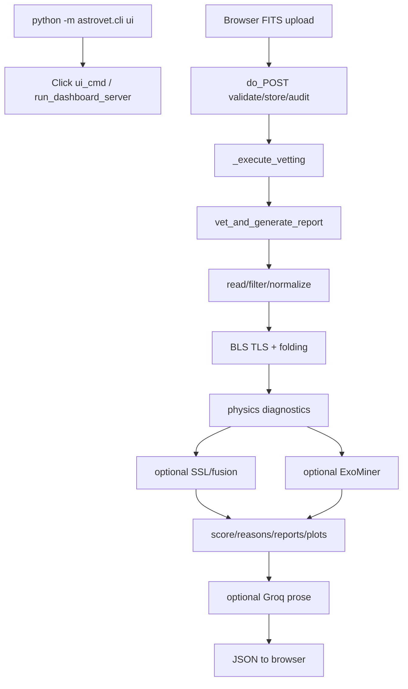

# ASTROVET: Technical Deep-Dive and Viva Preparation

**Audit date:** 2 November 2026  
**Repository:** `Subhra1432/ASTROVET`, branch `main`, commit `6a985fad`  
**Purpose:** Evidence-based summary of implementation, earlier run records, and remaining verification.

> [!CAUTION]
> ASTROVET is research triage, not planet confirmation. The catalog classifier predicts Astronet-Triage-v2 `E` versus `B/J`; `E` includes planets and non-contact eclipsing binaries. Never describe that classifier score as a planet probability.

## Evidence boundary

- **Verified** means inspected in this checkout/source or local artifact.
- **Recorded** means an earlier project report value, not freshly reproduced.
- **Not verified** means referenced data/model or execution was unavailable.
- Checkout is `C:\Users\kalap\Documents\MountE\Final Year Projet\ExoMiner-main\astrovet`. The historical `D:\Final Year Projet\ASTROVET_data` path is unavailable here. Raw CSV and documented full fusion bundle are absent from this checkout.

## 1. Project understanding

**Simple viva answer:** ASTROVET reads a TESS light-curve FITS, audits and cleans measurements, searches for recurring transit-like dips, computes physical consistency checks, optionally encodes the curve with self-supervised learning, and presents evidence for human review. A separate supervised fusion model was trained on a selected TOI disposition cohort. NASA ExoMiner/ExoMiner++ is an optional external comparison, not rewritten. Groq optionally rephrases a compact summary.

**Technical answer:** Input is time, flux, uncertainty and quality values from SPOC/QLP FITS plus optional candidate period, epoch, duration, depth and target metadata. Workflow: FITS validation; cadence filtering; segment-aware normalization/detrending; BLS/TLS; phase folding; approximate transit fit, odd/even, secondary, plausibility checks; optional 16-D SSL representation; optional baseline; local score/report. Missing branches should remain unavailable. Output is triage evidence, not astrophysical confirmation.

**Problem/users:** TESS produces many transit-like events. Dips may be eclipsing binaries, variability, systematics or noise. Intended users are researchers, students and human vetters. The project seeks consistent evidence presentation; reduced human workload has not been measured.

**Contribution/novelty:** Evidence supports an integrated, auditable prototype built from established methods. It does not support claims of a new BLS/TLS algorithm or proven superiority to ExoMiner++. Contribution: FITS workflow, parallel searches, diagnostics, SSL representation, supervised fusion prototype, external baseline integration, reports and UI.

**Boundaries:** It does not control telescopes, conduct follow-up or formally validate planets. Internet is needed for MAST/TESSCut/Groq; Docker is for optional live ExoMiner. Pixel cutouts are context, not time-series model input.

### Implemented, partial, unverified

| Capability | Status/evidence |
|---|---|
| FITS upload validation/audit | Implemented: `src/astrovet/lightcurves/validator.py`, `src/astrovet/ui/server.py`; representative rejection cases in `docs/validation_results.md`. |
| SPOC/QLP reader, quality filtering, normalization | Implemented: `lightcurves/reader.py`, `quality.py`, `normalization.py`; archive-wide support unproven. |
| BLS/TLS and physical screens | Implemented: `views/periodogram.py`, `physics/*.py`; screens are heuristics. |
| Self-supervised encoder | Implemented, checkpoints exist: `ssl/neural_encoder.py`; three small real-FITS NPZ checkpoints present, not the documented 11,511-file checkpoint. |
| Catalog E-vs-B/J classifier | Implemented; `artifacts/models/tce_e_vs_bj_classifier.joblib` exists; not planet identification. |
| TOI prototype/fusion head | Training code exists; historic metrics documented. Matching full fusion bundle absent here. |
| NASA baseline | External adapter/catalog and container workflow exist; local catalog absent. Prior report describes OOM. |
| Dashboard/report/pixel view | Implemented: `ui/server.py`, `ui/static/index.html`, `explain/report.py`, `pixel_preview.py`; parity evidence covers two files only. |
| Groq explanation | Optional `explain/groq_explainer.py`; live response not verified; cannot change result. |
| Broad scientific validation | Incomplete; blind cohort and injection grid pending in `docs/validation_results.md`. |

## 2. Algorithms and mathematical details

### Logistic regression (catalog model)

`src/astrovet/models/training.py` uses `sklearn.linear_model.LogisticRegression`. For features `x`, weights `w`, intercept `b`: `z=wᵀx+b`, `p=σ(z)=1/(1+exp(-z))`. The library minimizes regularized, class-weighted binary log loss (normalization is library-defined): `Σᵢ sᵢ[-yᵢlog(pᵢ)-(1-yᵢ)log(1-pᵢ)] + λ||w||²₂`.

Learned parameters are coefficients/intercept. Hyperparameters include `C`, solver, iterations, class weight, seed. `C` is inverse regularization (higher C means weaker penalty). Catalog run uses `lbfgs`, `max_iter=2000`, seed 42, balanced class weights; validation tests C `[.001,.01,.1,.5,1,5,10]` by PR-AUC, recorded winner 10. The optimizer is sklearn's L-BFGS.

`TabularFeaturePreprocessor` creates 12 numeric features from seven columns (`Period`, `Duration`, `Depth`, `SMass`, `SRad`, `SRadEst`, `Tmag`): three missingness flags; log10 period/duration/depth; duration/period duty cycle; effective stellar radius; log estimated planet radius; raw mass/radius/Tmag. Train-only medians and `StandardScaler` are reused. Approximate radius relation: `Rp/Re ≈ 109.076 × Rstar/Rsun × sqrt(depth_fraction)`; not a measured radius.

### Self-supervised encoder (not a classifier)

`src/astrovet/ssl/neural_encoder.py` is NumPy dense network 200→64→16 and decoder 16→64→200. LeakyReLU alpha=.1, He/Kaiming weights, zero biases, L2-normalized inference embedding. It learns from unlabeled views and cannot classify planets by itself.

For target `x`, masked/jittered views `x1,x2`, reconstruction `xhat1`, embeddings `z1,z2`, masked coordinates weighted `m=2` (otherwise 1), objective is `L=mean[m*(xhat1-x)^2] + λv*mean[(z1-z2)^2]`, `λv=.5`. Mask fraction=.15; jitter sigmas=.02/.04. Manual chain-rule gradients, global norm clip 5, Adam (`β1=.9, β2=.999, ε=1e-8`); CLI defaults 5 epochs, batch 16, lr .005, seed 42. CPU only, no auto-diff, early stopping or scheduler. Views are built by `ssl/dataset.py`; NPZ stores weights/provenance. Loss reduction is not proof of classification quality.

### Supervised fusion and signal diagnostics

`scripts/train_ssl_physics_fusion.py`: 16 SSL + 11 physics/missingness features (27; baseline excluded), train-only `StandardScaler`, class-balanced logistic regression C∈{.01,.1,1,10}, max_iter=3000, seed42. Validation average precision chooses C; Platt fits disjoint calibration hosts. Labels CP/KP vs FP/FA in follow-up-selected TOIs; not all TESS.

- **BLS:** scans trial period/phase/duration for box-like dips; Kovács, Zucker & Mazeh (2002). Peaks are not planet identity.
- **TLS:** scans transit-shaped templates; Hippke & Heller (2019). Sensitivity to small transit shapes does not prevent EB/artifact detections.
- **Approximate transit fit:** `physics/transit_model.py` uses `scipy.optimize.curve_fit` on approximate limb-darkening template for depth, duration, time offset. Reduced chi-square `Σ[(flux-model)/error]²/(n-3)`. Code explicitly sets `is_validated_physical_inversion=False`; not full Mandel & Agol inversion.
- **Odd/even:** alternating event depths; Welch test when possible, pooled/normal approximation or abstain. Mismatch may indicate EB; agreement doesn't exclude one.
- **Secondary:** phase≈.5; project flags SNR≥3, depth ratio≥.08 and >80 ppm. Heuristic, not universal physical law.
- **Platt calibration:** logistic mapping on logit(raw score) using calibration labels; can't remove selection bias.
- **Metrics:** ROC-AUC ranking; average precision prevalence-sensitive; Brier `mean((p-y)^2)`; ECE weighted bin gap. Precision=TP/(TP+FP), recall=TP/(TP+FN), F1=2PR/(P+R).

Random Forest, SVM, XGBoost and supervised neural classifiers are not trained in main paths. They are possible comparisons, not current methods. No benchmark proves logistic regression superior.

## 3. Dataset forensics

### Catalog CSV

`artifacts/reports/tces_v3_audit.json` records `tces_with_labels_v3.csv`, 24,926 rows × 23 columns, 3,135,630 bytes, SHA-256 `8c4412b073ac3fb02b8b8ee61be32d25d002cd569d4975f848cf8deddcadc1bb`. Raw CSV is absent; recorded path `D:\Final Year Projet\tces_with_labels_v3.csv` unavailable, so these values are historical, not recomputed today.

Columns: TIC ID, Epoch, Period, Duration, Depth, SMass, SRad, SRadEst, Tmag, Year, MinT, MaxT, Split, Consensus Label, L1-L8, Notes. Recorded label counts: J=15,803; missing=5,340; E=2,613; B=741; S=275; N=154. E/B/J cohort=19,157 rows/19,145 hosts; E prevalence 13.64%; S/N/missing excluded=5,769. Reported missing SMass=12,442 (49.92%), SRad=2,820 (11.31%), SRadEst=579 (2.32%); zero exact duplicates, 38 repeated TIC rows.

`load_and_audit_dataset()` in `models/training.py` checks path, hash/size, reads UTF-8 errors ignored, pandas `read_csv(low_memory=False)` (comments supported), drops recognized units row, validates required columns, coerces TIC, retains E/B/J and maps E→1. Whole CSV loads into pandas memory; no chunk/lazy load. Missing file raises `FileNotFoundError`; bad schema `ValueError`; comma default. E includes eclipsing binaries, not planet truth.

### FITS and disposition cohorts

FITS is an astronomy binary container, not necessarily an image. Light-curve FITS stores timestamps, flux, uncertainty, flags and headers; pixel FITS stores spatial arrays. ASTROVET's primary input is the former. Checkout has two 1,958,400-byte copies of a Sector 23 SPOC FITS for TIC 390651552; full QLP archive and fusion bundle are absent.

`docs/implementation_status.md` records prior download: 8,151 TOI rows; 107 MAST TCE catalogs (156,431 rows; 248.09 MB); 18,121 period/epoch matches; hard-label cohort 1,782 events/1,734 hosts (CP 565, KP 489, FP 706, FA 22). One run yielded 1,771 FITS feature rows, 11 missing. Later run removed 20 held-out hosts seen in SSL, producing 1,751 features. D: data/manifests are unavailable; historical figures only. MAST/SPOC/QLP products are public; model/data artifacts are local/ignored by Git.

Limitations: imbalance, missing stellar metadata, label ambiguity/noise, selected TOI follow-up bias, sector/pipeline/cadence shifts. Host-disjoint random split is not temporal or independent-source test.

## 4. Preprocessing and execution traces

### Catalog path

```text
24,926 × 23 raw (audit record)
→ E/B/J: 19,157 × 23; 5,769 excluded
→ 19,145 TIC groups; 60/15/10/15 train/validation/calibration/test, seed 42
→ 12 derived features from 7 numeric columns
→ train-only median imputation + StandardScaler
→ fit logistic model on train; choose C by validation PR-AUC
→ fit Platt on calibration; evaluate test once
```

Rows remain constant; columns change. IDs, labels, votes, notes, supplied split and time-boundary fields excluded. Fitted medians/scaler/order stored and reused.

### FITS inference

```text
Browser upload (/api/upload_and_vet or /api/upload)
→ size/type/signature/readability validation; save original + hash + audit
→ choose SPOC PDCSAP_FLUX or QLP KSPSAP_FLUX
→ finite/quality filtering → gap segmentation/normalization/detrending
→ supplied ephemeris or BLS/TLS → folded transit/full/odd/even views
→ approximate fit, odd/even, secondary, plausibility diagnostics
→ optional SSL embedding + physics vector + optional fitted fusion
→ optional reference catalog or explicit container baseline
→ score/reasons/report/plots; optional TESSCut pixel image
→ JSON to browser; optional Groq prose from sanitized summary
```

Prior cleaning test injected a 1000-ppm box into each of two real files and recovered depth for those cases. This does not prove general transit preservation over periods/noise/gaps/cadences. Original upload is retained unchanged.



### Function contracts

| Function | Input → operations → output |
|---|---|
| `cli()`/`ui_cmd()` in `src/astrovet/cli.py` | host/port → local HTTP server; console entry `astrovet=astrovet.cli:main`. |
| `do_POST()` in `ui/server.py` | upload + metadata → validate/store/audit → `_execute_vetting`; arbitrary paths rejected. |
| `_execute_vetting()` | candidate/FITS/optional ephemeris → report pipeline → JSON and artifact links. |
| `read_tess_fits_lightcurve()` | FITS → time/flux/error/quality/header data. |
| `filter_quality_cadences()` / `segment_and_normalize_lightcurve()` | arrays → retained cadences, segments and normalized curve/audit. |
| period search in `views/periodogram.py` | series + optional ephemeris → BLS/TLS outputs/agreement. |
| `run_physics_diagnostics()` | folded/raw series → fit and consistency checks. |
| `SelfSupervisedTransitEncoder.encode()` | length-200 view(s) → median/MAD cleaning → 16-D vector. |
| `AstrovetFusionModel.predict_single()` | optional baseline + physics + embedding → fitted score or fallback triage. |
| `generate_groq_explanation()` | compact JSON + env key → structured prose, non-fatal. |
| `run_training_pipeline()` | CSV → audit/splits/transforms/tuning/calibration/test/report/joblib. |
| `scripts/train_ssl_physics_fusion.py:main()` | cohort/manifest/split/checkpoint → features, model, calibration, metrics. |

## 5. Results and their limits (not rerun)

### Catalog E-vs-B/J saved report

Recorded host counts train/validation/calibration/test: 11,487/2,871/1,914/2,873; events: 11,489/2,874/1,916/2,878; seed 42 and zero overlap. Selected C=10. Test N=2,878: 390 E, 2,488 B/J, prevalence .1355. ROC-AUC .8901; average precision .5368; raw→calibrated Brier .1417→.0825; ECE .2027→.0222. At threshold .5: precision .6069, recall .4077, F1 .4877; confusion `[[TN 2385,FP 103],[FN 231,TP 159]]`. Precision@10=.50, @25=.60, @50=.68; recall-at-precision ≥80% entries zero. These are catalog label metrics, not planet accuracy.

Implied accuracy 88.4%; majority-negative baseline 86.45%, so accuracy alone is weak. Long-period PR-AUC recorded .1296 (15 positive of 969); shallow <500 ppm .1782. No CIs, repeated seeds or independent temporal test reported.

### Full QLP SSL+fusion report

Historical docs report 11,511 FITS/11,487 train hosts; 1,171,623 views; five CPU epochs, batch 16; loss .765910→.760074. Fusion cohort 1,751 rows; partitions train 1,061 events/1,033 hosts, validation 266/256, calibration 168/163, test 256/251. Test ROC-AUC .8039, PR-AUC .8377 at prevalence .5781; Brier .1819→.1795; ECE .0983→.0825; threshold .5 precision .7322, recall .9054, F1 .8097; confusion `[[59,49],[14,134]]`. Selected follow-up cohort only.

**Artifact distinction:** Full D: model bundle is unavailable here. Checkout has three small real-FITS NPZ checkpoints (single-file provenance says 135 views) and catalog joblib. It lacks the documented matching full fusion model. These metrics do not prove today's UI loads it.

### Leakage and deployment

Controls: TIC-grouped partitions; IDs/labels/votes/notes/time boundaries excluded; train-only transforms; validation C selection; calibration-only Platt; untouched test; SSL train-host manifest option; later report documents held-out host removal; checkpoint compatibility checks; missing baseline not fabricated.

Risks: random group split is not future sector/source test; E conflates planets/binaries; TOIs are selected; no CIs/repeated seeds; narrow injections; artifacts may be absent; one historical FITS shorter than header was parsed. No full security audit. Inference needs compatible local artifacts; otherwise heuristic/unavailable. Groq is called after local result, gets coarse non-identifying fields only, cannot change score. Render prose as text and keep API key environment-only.

### Pending verification checklist

1. Restore/version exact full encoder, fusion joblib, cohort/manifests; verify hashes, compatibility and dashboard launcher.
2. Rerun full tests after recent changes (not run in this audit).
3. Compare browser/CLI/report on broader labeled SPOC/QLP; assert score/model/calibration provenance parity.
4. Run injection/recovery grid over depth, period, duration, variability, noise, gaps, flags, cadence, sector, pipeline.
5. Freeze model/threshold then evaluate blinded independent/temporal/pipeline cohort; report PR, precision/recall at review capacity, calibration, CIs, subgroups and coverage.
6. Revalidate calibration at deployment prevalence; no population-wide probability claim.
7. If live ExoMiner required, demonstrate complete real inference within memory; else report unavailable.
8. Verify Groq with rotated key and inspect transmitted data; never commit key.

## 6. Annotated dataset-loading code

From `load_and_audit_dataset()` in `src/astrovet/models/training.py`:

```python
p = Path(file_path)
if not p.is_file():
    raise FileNotFoundError(...)
file_size = p.stat().st_size
file_sha256 = compute_sha256(p)
with open(p, "r", encoding="utf-8", errors="ignore") as f:
    first_line = f.readline().strip()
if first_line.startswith("#"):
    df_raw = pd.read_csv(p, comment="#", low_memory=False)
else:
    df_raw = pd.read_csv(p, low_memory=False)
...
df_raw["TIC ID"] = pd.to_numeric(df_raw["TIC ID"], errors="coerce").astype(np.int64)
valid_mask = df_raw["Consensus Label"].isin(["E", "B", "J"])
df_valid = df_raw[valid_mask].copy().reset_index(drop=True)
df_valid["target"] = (df_valid["Consensus Label"] == "E").astype(int)
```

It verifies file/provenance, loads the whole CSV in memory, supports comments/units row, validates schema, converts TIC, excludes uncertain labels and creates E-vs-B/J target. FITS reading is separate.

## 7. Project-specific viva question bank (100)

Answers include a simple answer then a technical anchor. File paths are relative to the repository.

### A. Basic project questions (15)

1. **What is ASTROVET?** Simple: TESS candidate triage. Technical: FITS→search/diagnostics→optional SSL/fusion→report; `ui/server.py:_execute_vetting`, `explain/report.py`. Verified.
2. **What problem?** Transit-like dips have non-planet causes; multiple clues aid human review. `physics/*.py`.
3. **Who uses it?** Researchers/students/vetters; UI is human-review oriented. No user study.
4. **Why important?** Many events need review; time saved is not measured.
5. **What if unsolved?** Manual vetting continues; impact not quantified.
6. **Existing approach?** Search pipelines plus human/ML vetting; ASTROVET integrates searches and adapter. Verified high-level.
7. **Existing disadvantages?** Model/label scope can limit use; do not claim all other methods fail. `model_card.md`.
8. **Proposed approach?** Physics evidence plus SSL and supervised fusion. Encoder/fusion files.
9. **What is different?** Integrated auditable workflow; superiority unproven.
10. **Contribution?** Implemented prototype, not a new BLS/TLS method.
11. **New or improvement?** New project workflow built on established methods; ExoMiner external.
12. **Input/output?** FITS + optional ephemeris → evidence/triage/report. Server/schemas.
13. **Assumptions?** FITS metadata usable and calibration data matches deployment; latter is risky.
14. **Boundaries?** Screening only; no follow-up or confirmation.
15. **Done/partial?** Core code exists; broad validation/artifact availability open.

### B. Machine learning (20)

16. **Supervised catalog algorithm?** Logistic regression; `models/training.py`.
17. **Target?** E vs B/J, not planet; model card.
18. **Equation?** `σ(wᵀx+b)`.
19. **Loss?** Class-weighted regularized binary log loss; sklearn implementation.
20. **C?** Inverse regularization; saved winner 10.
21. **Optimizer?** `lbfgs`, max_iter 2000.
22. **Why logistic?** Efficient, simple fixed-width baseline; not proved best.
23. **Why not Random Forest?** Not trained; nonlinear baseline remains to compare.
24. **Why not SVM?** Not trained; probability calibration/scale need comparison.
25. **Why not XGBoost?** Not in main training path; no benchmark.
26. **Neural classifier?** Encoder is neural, fusion head logistic; do not conflate.
27. **SSL means?** self-generated reconstruction/view targets without labels.
28. **What learned?** MLP/decoder weights, not planet classes.
29. **SSL loss?** reconstruction MSE + .5 consistency MSE, mask weight 2.
30. **Optimizer?** manual backprop, clip 5, Adam .9/.999/1e-8, lr .005.
31. **Parameters/hyperparameters?** weights learned; C/lr/epochs/dimensions configured.
32. **Fusion?** 16 SSL + 11 physics inputs, standardized logistic head.
33. **Platt?** logistic mapping fitted on disjoint calibration set.
34. **Compute?** CPU NumPy/sklearn; full performance benchmark absent.
35. **10× data?** batching exists, but view extraction may use memory; streaming needed.

### C. Dataset questions (20)

36. **What is CSV?** Astronet-Triage-v2 TCE catalog; audit reports 24,926×23; raw absent.
37. **Origin?** Project cites Tey 2023/Zenodo; exact file unavailable now.
38. **Columns?** TIC, transit/star values, labels/votes/time/notes; audit JSON.
39. **Classes?** E/B/J/S/N/null; only E/B/J retained.
40. **Why E not planet?** Includes binaries; code and paper.
41. **Why exclude S/N/null?** uncertain/unlabeled, not safe negatives.
42. **Balanced?** No; E prevalence 13.64% in usable rows.
43. **Missingness?** SMass ~49.92%; flags+train medians.
44. **Duplicates?** Audit says zero exact rows, 38 repeated TIC; not rechecked raw.
45. **SSL data?** real FITS; full QLP run documented, not present.
46. **Fusion cohort?** CP/KP vs FP/FA selected TOIs.
47. **Source?** MAST TESS; downloads remain local.
48. **Why FITS?** precise time-series flux/quality needed for transit search.
49. **Pixel image input?** no, supplemental context only.
50. **Loaders?** pandas CSV and FITS reader separate.
51. **Batch CSV?** no, whole DataFrame.
52. **Encoding/delimiter?** UTF-8 errors ignored, comma default, optional comments.
53. **Missing file?** FileNotFoundError; schema ValueError.
54. **Public?** sources public, artifacts not all tracked.
55. **Bias/noise?** plausible/documented; no quantified label-noise study.

### D. Preprocessing/features (15)

56. **CSV transforms?** numeric coercion, logs, duty cycle/radius features.
57. **Missing handling?** flags plus train medians.
58. **Why scaling?** disparate units; train-only to avoid leakage.
59. **Dimension change?** seven columns→12 features, same rows.
60. **Flux fields?** docs specify SPOC PDCSAP/QLP KSPSAP; verify fallback before viva.
61. **Noise filtering?** finite/quality filtering, segmentation/detrending; not all artifacts.
62. **Could cleaning erase transit?** yes; two isolated injections only, broader grid pending.
63. **Why segment gaps?** avoid trends across discontinuities.
64. **SSL scaling?** median/MAD, interpolation, clip ±8.
65. **Dimensions?** 200 bins, embedding 16.
66. **Split timing?** before fitting transforms; fusion scaler train-only.
67. **Inference reuse?** stored scaler/medians/order and checkpoint.
68. **Leakage?** train-only and host manifest safeguards; verify each run.
69. **Schema drift?** validate/fail, don't fabricate.
70. **Remaining test?** multi-factor injections across pipeline/cadence/gaps.

### E. Training and evaluation (15)

71. **Catalog entry?** CLI `model train`→`run_training_pipeline()`.
72. **SSL entry?** `ssl pretrain`→`ssl_pretrain_cmd`→encoder.fit.
73. **Fusion entry?** `scripts/train_ssl_physics_fusion.py:main()`.
74. **Epoch/batch?** pass/update group; 5 epochs, batch16 defaults.
75. **Early stopping?** none in SSL.
76. **Checkpoints?** NPZ encoder, joblib classifier.
77. **Selection?** validation PR-AUC chooses C; test untouched.
78. **Test set?** 15% host split recorded; not necessarily future data.
79. **Metrics?** PR/ROC, P/R/F1, Brier/ECE, subgroups, precision@k.
80. **Confusion?** 2385 TN,103 FP,231 FN,159 TP at .5.
81. **Accuracy?** 88.4% vs 86.45% majority; insufficient alone.
82. **PR-AUC?** .5368 vs .1355 prevalence; not planet accuracy.
83. **Confidence intervals?** not reported; group bootstrap recommended.
84. **Repeated runs?** not reported; seed42 single run.
85. **Reproducible?** hashes/manifests help, but raw/full model absent from Git.

### F. Architecture (10)

86. **First code?** `astrovet.cli:main` console entry.
87. **Upload flow?** `do_POST`→audit→`_execute_vetting`→report→JSON.
88. **Model load scope?** don't assert once/request without verifying report path.
89. **Baseline absent?** unavailable, not fabricated zero.
90. **Output path?** `artifacts/reports`, reports/PNGs.
91. **Docker purpose?** isolate upstream; not GPU acceleration; OOM recorded.
92. **Groq?** optional prose with environment key; live response unverified.
93. **Does Groq change score?** no.
94. **Upload security?** validation/path checks, not full security review.
95. **Bad FITS?** validation error; synthetic upload fallback disabled.

### G. Research questions (5)

96. **Research gap?** integration is motivation; formal literature review absent.
97. **Evidence?** established methods, selected cohort metrics, two real-file checks; broader test absent.
98. **Domain shift?** warnings/availability flags exist; drift adaptation unvalidated.
99. **Prove value?** frozen blind benchmark and reviewer-capacity/injection metrics; pending.
100. **More time?** restore artifacts, blind cohort, injection grid, CIs, cross-pipeline.

## 8. Twenty challenging follow-ups

1. **E contains binaries, why planet classifier?** It isn't; separate catalog signal label task.
2. **ROC .89 but recall .41?** ROC ranks thresholds; report operating point separately.
3. **Calibration generalizes?** Unknown outside cohort; test at deployment prevalence.
4. **Could test hosts occur in SSL?** yes unless manifest enforced; check run audit.
5. **SSL labels?** no; fusion labels yes.
6. **Why SSL objective?** proxy reconstruction/invariance; downstream test still required.
7. **Does loss prove quality?** no.
8. **Clip ±8 physical?** no, numerical guard; sensitivity study needed.
9. **Preserve long transits?** not established; grid pending.
10. **BLS/TLS disagree?** route for review, retain disagreement.
11. **No secondary rules out EB?** no.
12. **Why 0.08 secondary ratio?** heuristic, validate empirically.
13. **Physical transit fit?** approximate, explicitly not inversion.
14. **Why unlabeled vs labeled counts differ?** SSL and supervised roles differ.
15. **Independent test?** host-disjoint, not necessarily time/source independent.
16. **TIC duplicates leak?** grouping keeps host together.
17. **Why omit TIC feature?** avoid identifier memorization.
18. **Schema changes?** should error, not guess.
19. **Structured Groq output truth?** only format guaranteed, prose untrusted.
20. **Complete?** implementation is substantial; broad validation/artifact availability open.

## 9. Mock viva

### ML researcher

**Q:** Why logistic and are probabilities reliable?  
**Answer:** “Catalog baseline uses class-weighted logistic regression over 12 features; validation PR-AUC chooses C and separate hosts fit Platt. Target is E-vs-B/J. Recorded PR-AUC .5368 at .1355 prevalence and calibrated Brier .0825, only on this cohort. Need independent validation and intervals.” Evidence: `models/training.py`, `calibration.py`, `docs/model_card.md`.

**Q:** Explain SSL.  
**Answer:** “NumPy 200-64-16 encoder/decoder reconstructs masked views and aligns jittered embeddings without labels; downstream fusion uses labels. Loss drop alone is not class quality.” Evidence: `ssl/neural_encoder.py`.

**Q:** Leakage?  
**Answer:** “TIC grouping, train-only transforms, validation tuning, calibration-only Platt and untouched test. Newer run documents held-out hosts removed from SSL. Check exact manifest; this is not future-sector testing.”

**Study:** label scope, thresholds, PR prevalence, calibration, host overlap, confidence intervals.

### Software engineer

**Q:** Trace upload.  
**Answer:** “Click starts HTTP server; `do_POST` validates/stores/audits; `_execute_vetting` calls report pipeline and serializes JSON. Invalid data errors; optional missing output remains unavailable.” Evidence: `cli.py`, `ui/server.py`, validator.

**Q:** Model pairing?  
**Answer:** “Bundle records feature names/scaler and compatibility guard exists, but full bundle is absent from this checkout, so runtime pairing cannot be proven.” Evidence: `models/fusion.py` and inventory.

**Q:** Groq?  
**Answer:** “Only coarse wording summary leaves; environment key; prose can't score. Live request with rotated key still needs verification.” Evidence: `groq_explainer.py`.

**Study:** load scope, failures, upload limits, artifact versioning.

### External examiner

**Q:** Novelty?  
**Answer:** “Integrated established searches/diagnostics/SSL into auditable triage, not new BLS/TLS or proven ExoMiner improvement. Current evidence is selected cohort and narrow smoke cases.”

**Q:** General TESS?  
**Answer:** “No; follow-up cohort selection shifts prevalence. Treat as review priority until independent test.”

**Q:** Main limitation?  
**Answer:** “External validation and artifact reproducibility; need blind cross-pipeline data, injection grid and full model bundle.”

**Avoid:** confirmed planet claims; conflating CSV and FITS models; ROC as calibration; Groq as detector; no-secondary as proof; TESS-wide claims from two files.

## 10. Sources and core answers

### Repository sources

`README.md`; `docs/implementation_status.md`, `model_card.md`, `validation_results.md`, `data_dictionary.md`, `label_policy.md`, `upload_workflow.md`; `src/astrovet/cli.py`; `models/training.py`, `fusion.py`, `calibration.py`; `ssl/neural_encoder.py`, `dataset.py`; `lightcurves/reader.py`, `quality.py`, `normalization.py`, `validator.py`; `views/periodogram.py`, `folding.py`; `physics/*.py`; `baseline/adapter.py`, `container.py`; `explain/report.py`, `pixel_preview.py`, `groq_explainer.py`; scripts for cohort and training.

### Authoritative external references

- [MAST TESS mission archive](https://archive.stsci.edu/missions-and-data/tess)
- [NASA/HEASARC TESS data products](https://heasarc.gsfc.nasa.gov/docs/tess/data-products.html)
- [NASA/HEASARC TESS documentation/SPOC](https://heasarc.gsfc.nasa.gov/docs/tess/documentation.html)
- [MIT TESS QLP](https://tess.mit.edu/qlp/)
- [Tey et al. 2023 Astronet-Triage-v2](https://doi.org/10.3847/1538-3881/acad85), [Zenodo 7411579](https://zenodo.org/records/7411579)
- [NASA ExoMiner](https://github.com/nasa/ExoMiner), [ExoMiner++ paper](https://arxiv.org/abs/2502.09790)
- [Astropy BLS documentation](https://docs.astropy.org/en/stable/api/astropy.timeseries.BoxLeastSquares.html)
- [Hippke & Heller 2019 TLS](https://arxiv.org/abs/1901.02015)
- [Groq chat](https://console.groq.com/docs/text-chat), [structured outputs](https://console.groq.com/docs/structured-outputs), [API reference](https://console.groq.com/docs/api-reference)

### Final answers to memorize

1. **Built:** TESS candidate triage with FITS processing, BLS/TLS, physics checks, SSL features, optional supervised fusion, human-readable evidence.
2. **Purpose:** organize human review of transit-like signals with multiple causes.
3. **Flow:** upload→filter/normalize→search/physics→optional SSL/fusion/baseline→triage/report.
4. **ML:** NumPy SSL encoder; separate sklearn logistic catalog and fusion heads; Platt calibration.
5. **Data:** MAST FITS, Astronet-Triage-v2 catalog, matched TOIs; local artifacts aren't all in Git.
6. **Evaluation:** host-held-out test but selected cohort; no broad independent validation.
7. **Limitations:** ambiguous target, follow-up selection, missing full model in checkout, narrow injections.
8. **Next:** restore artifacts, rerun tests, blind validation and injection grid.
9. **Groq:** optional wording only; no score effect.

---

**Verification statement:** This is a code/artifact audit, not a rerun of every training job. Historical metrics are explicitly prior records. Raw CSV and full fusion model were unavailable. Current full test suite and live Groq request were not run.
